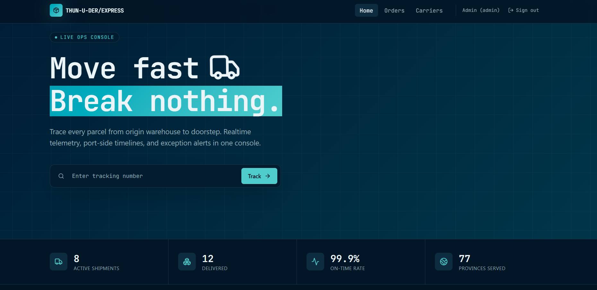

# Thun-u-der Express — Shipment Tracking Dashboard

Shipment tracking dashboard with public shipment views, staff operations, analytics, and a separately deployed Go API.



## Supported stack

- Frontend: Next.js App Router, React, TypeScript, deployed on Vercel.
- Backend: Go/Fiber API with PostgreSQL, deployed separately.
- Browser requests use the Next.js origin. Next server routes proxy `/api/*` to Go and preserve the HTTP-only auth cookie.

## Setup

```bash
cd backend
cp .env.example .env
# Configure database and JWT settings, then start the API.
docker compose up
```

In another terminal:

```bash
cd frontend
bun install
cp .env.example .env.local
# Set API_BASE_URL to the Go API origin, without /api.
bun run dev
```

Frontend runs at `http://localhost:3000`; local Go API runs at `http://localhost:8080`.

## Frontend scripts

Run from `frontend/`:

| Command | Purpose |
| --- | --- |
| `bun run dev` | Start Next.js development server |
| `bun run build` | Build production Next.js app |
| `bun run start` | Start production Next.js app |
| `bun run lint` | Run ESLint |
| `bun run test:e2e` | Run Next.js Playwright tests |

## Environment and production cutover

Frontend requires server-only `API_BASE_URL`, the Go API origin without `/api`. `OPENCAGE_API_KEY` is needed for geocoding. `NEXT_PUBLIC_CARTO_API_KEY` is an optional public tile key. Never expose backend or geocoding secrets through `NEXT_PUBLIC_*`.

In Vercel, set `API_BASE_URL` to the separately deployed Go origin. Browser components request same-origin `/api/*`; Next.js proxies to Go. Go retains its endpoint contract and enforces auth and staff-only writes. The login screen visibly displays the read-only demo account `demo@shipitout.example` / `demo-read-only-2026`; there is no guest mode. Production cutover preserves accounts and shipments, demotes pre-existing admins once, and grants write access only to the newly seeded admin and staff. See `docs/adr/0001-nextjs-frontend-api-origin.md` and `docs/adr/0002-staff-only-writes.md`.

## Test coverage

`frontend/tests/e2e/next-*.spec.ts` covers navigation, public SSR, cookie authentication, staff writes, demo denial, and shipment/hub/analytics flows using a local API-compatible fixture. Live production smoke must also verify navigation, public SSR, cookie login, a staff write, and demo denial across deployed Next.js and Go origins. Do not run smoke against production without an approved test account and disposable test record.

## Backend API

Go API contract remains under `/api`; see `backend/docs/OVERVIEW.md` and `backend/docs/WORKFLOW.md` for endpoints and behavior.
